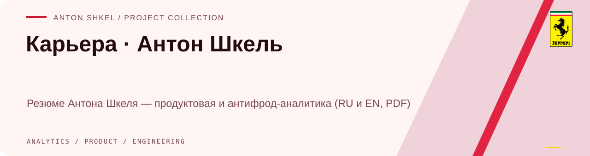

<picture><source media="(prefers-color-scheme: dark)" srcset="assets/portfolio-dark.svg"></picture>

[Профиль](https://github.com/antonshkelll) · [Портфолио](https://antonshkel.ru)

# Антон Шкель — резюме

Продуктовая и антифрод-аналитика · данные · финтех

[-0071e3?style=for-the-badge)](resume/Anton_Shkel_Resume_RU.pdf)
[-1d1d1f?style=for-the-badge)](resume/Anton_Shkel_Resume_EN.pdf)

Студент программной инженерии Финансового университета при Правительстве РФ (факультет ИТ и анализа больших данных).
Ищу стажировку продуктового или антифрод-аналитика.

| Резюме | Язык | Файл |
|---|---|---|
| Антон Шкель | русский | [Anton_Shkel_Resume_RU.pdf](resume/Anton_Shkel_Resume_RU.pdf) |
| Anton Shkel | English | [Anton_Shkel_Resume_EN.pdf](resume/Anton_Shkel_Resume_EN.pdf) |

## Хакатоны

**Альфа-Будущее Хакатон 2026 · Vibe Security** — участие в создании «Умного кредитного кабинета предпринимателя».
Продуктовая проработка, сценарии и тексты интерфейса; WireMock-моки ЕГРЮЛ, ФНС, БКИ и банка, синтетические профили и сценарии сбоев для интеграции и демо.

[Командный MVP: код, архитектура и запуск](https://github.com/antonshkelll/alfa-hack-2026-ai-credit-cabinet).

**Hack&Change 2026 — планируемое участие.** Планируемая роль: продуктовая проработка и мок-сервисы.

## Проекты из резюме

| Проект | О чём |
|---|---|
| [Subly](https://github.com/antonshkelll/Subly) | трекер подписок: Android, сервер на Ktor, оплата, админка |
| [Экономика быстрого платежа](https://github.com/antonshkelll/sbp-economics) | исследование СБП и цифрового рубля, калькулятор для бизнеса |
| [SplitLab](https://github.com/antonshkelll/splitlab-bnpl-analytics) | продуктовая аналитика BNPL: метрики, юнит-экономика, A/B-тест |
| [Uplift](https://github.com/antonshkelll/uplift-targeting) | uplift-моделирование на реальном эксперименте |
| [DropHunter](https://github.com/antonshkelll/drophunter-antifraud) | антифрод: поиск дропперов, порог по деньгам |
| [TxGPT](https://github.com/antonshkelll/txgpt-llm-from-scratch) | GPT с нуля для категоризации операций |
| [finpilot](https://github.com/antonshkelll/finpilot-mcp) | MCP-сервер для анализа банковской выписки |
| [Пульс рынка](https://github.com/antonshkelll/ru-market-pulse) | дашборд по данным Мосбиржи, обновляется сам |
| [Спроси ССт НАБ](https://github.com/antonshkelll/nab-bot) | бот и Mini App студсовета, живые пользователи |

## Контакты

[anton.shkel06@mail.ru](mailto:anton.shkel06@mail.ru) · [Telegram](https://t.me/antonshkelll) · [antonshkel.ru](https://antonshkel.ru) · [GitHub](https://github.com/antonshkelll)
